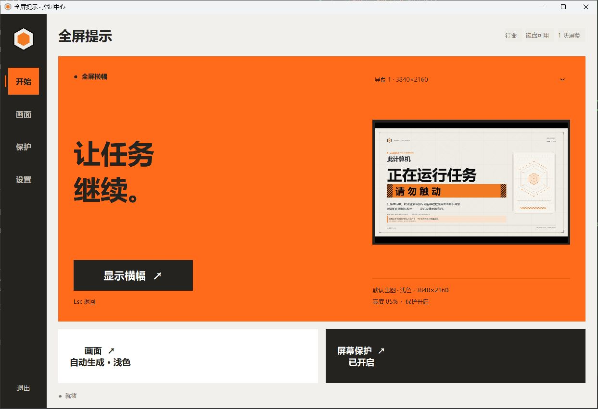
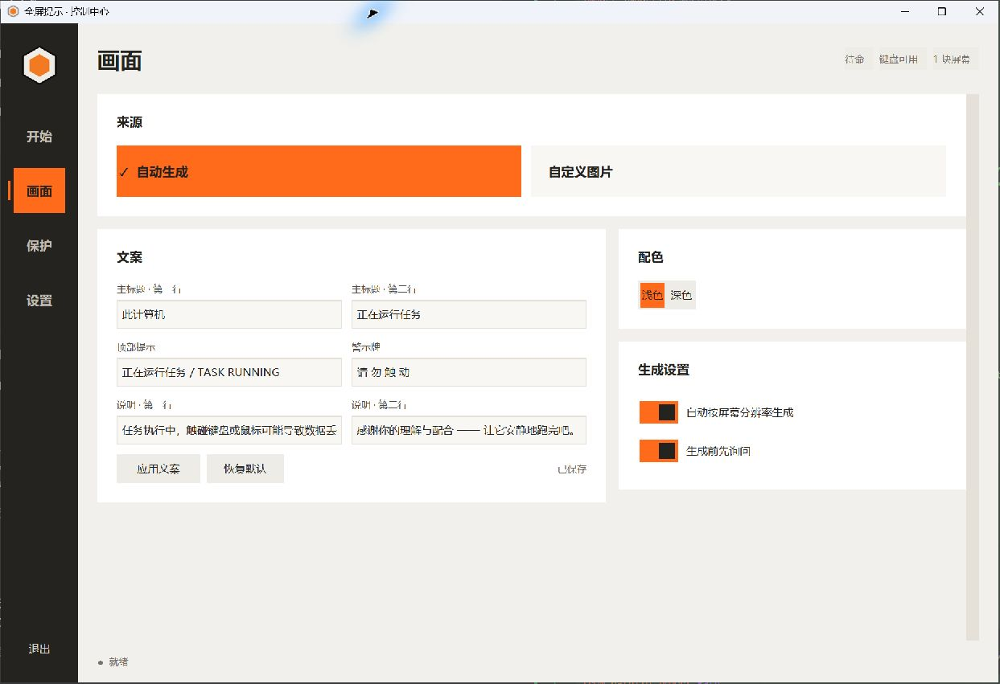
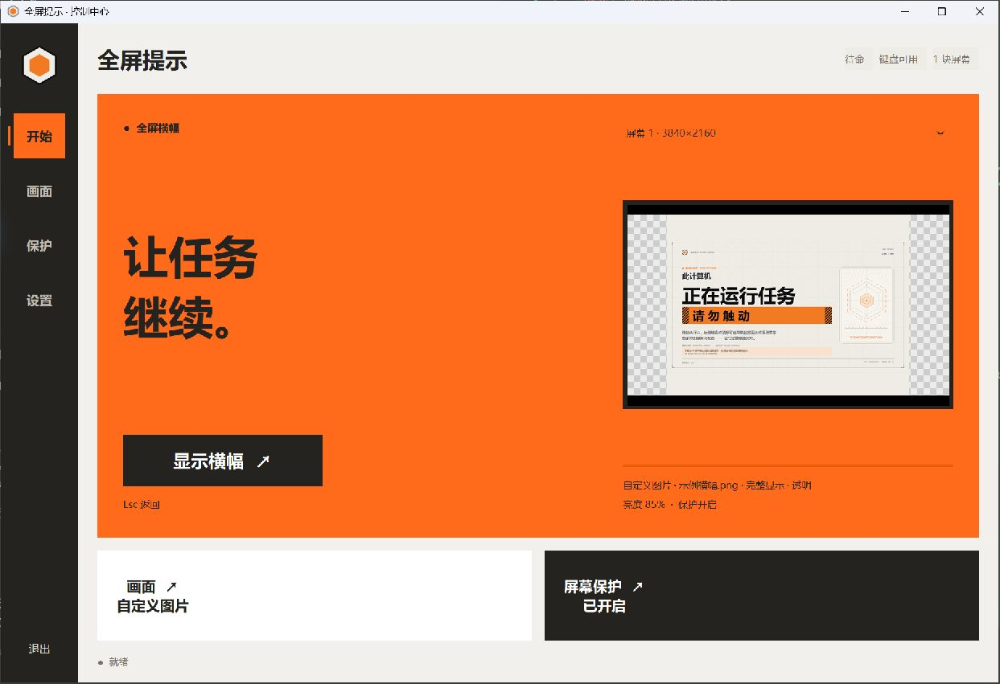

# 全屏提示横幅（OLED 防烧屏版）

> 版本 **1.6** · Windows 10/11 x64 · 托盘常驻 · 图形化控制中心 · 档案风双配色横幅 · 自定义图片 · OLED 防烧屏

托盘常驻的小工具：左键单击托盘图标，所有显示器铺满「请勿触动」全屏横幅并屏蔽键盘（鼠标不屏蔽，`Esc` 关闭）；
长时间无人操作自动进入纯黑暗屏守护，配合周期性微移与亮度衰减，降低 OLED 烧屏风险。
v1.6 的控制中心重构为「开始 / 画面 / 保护 / 设置」四个独立页面，采用直角黑白橙设计与斜切遮罩；默认横幅支持浅 / 深双配色，
并支持**真正透出桌面**的透明未填充区域。

- 版本：1.6
- 运行环境：Windows 10/11 x64
- 依赖：Pillow + customtkinter（源码运行）；安装版内置 Python 运行时与全部依赖，无需另装
- 配置 / 日志：`%LOCALAPPDATA%\Banner`

> 本项目基于 [Hannyueh/Fullscreen-Banner](https://github.com/Hannyueh/Fullscreen-Banner)（MIT）修改并重写；
> 主要变更见上方「更新日志」。原始版权声明见 [LICENSE](LICENSE)。

## 更新日志

> 最近版本在前；完整发布说明见 [RELEASE_NOTES.md](RELEASE_NOTES.md)。

### v1.6（当前版本）

- 直角黑白橙界面、蜂巢标识、纯文字导航和四个独立页面。
- 原生斜切橙色遮罩，完整覆盖时换页，带加减速曲线和快速连点处理。
- 修复无键盘钩子时的 Esc 关闭；改善保存反馈、配置写入与最新横幅生成。
- 构建自动验证运行依赖、字体、转场接口、Esc 和图片解码，并检查安装包体积。
- 精简未使用的 NumPy / OpenBLAS、OpenSSL 等依赖；相比[原版 v1.5](https://github.com/Hannyueh/Fullscreen-Banner/releases/tag/v1.5)，安装包从 **22.44 MiB 降至 11.57 MiB（缩小 48.4%）**，保留核心功能与图片格式支持。

### v1.5

> 本次发布基于仓库 v1.4，包含控制中心与档案风双配色横幅改版。

- **控制中心**：新增图形化控制中心，两栏「横幅 / 息屏」；横幅页先选来源（自动生成 / 自定义图片），再按来源显示对应设置；顶部状态、右侧实时预览、改动即时保存
- **默认横幅重做**：档案风格版式 + 浅色 / 深色两套配色；文案 6 项可编辑（顶部提示行、两行主标题、警示牌、两行说明），移除状态行
- **自定义图片增强**：任意格式 / 尺寸；铺满裁切、完整显示、拉伸三种适配；「完整显示」新增未填充黑边 / 透明，透明通过 Windows 分层窗口色键**真正透出桌面**
- **图标更换**：托盘 / 窗口 / exe / 安装包图标统一为更加普适美观的几何六边形，不再使用具象化金色锁头
- **配置调整**：新增 `banner_theme`、`banner_eyebrow`、`contain_fill`，移除 `banner_status`；隐藏输入法状态条固定默认开启
- **新增自检**：`tests/banner_checks.py`、`tests/gui_checks.py`、`tests/custom_image_checks.py`

### v1.4

- 支持导入任意格式 / 尺寸的自定义图片；铺满裁切、完整显示、拉伸三种适配方式

### v1.3

- 增加 PyInstaller + NSIS 构建与安装包流程

### v1.2

- 重写为多分辨率自动出图与 OLED 防烧屏

---

## 功能一览

- **全屏横幅**：多显示器、按每块屏幕分辨率 1:1 出图，16:9 / 21:9 / 竖屏 / 4K 都能自适应
- **键盘屏蔽 + 防锁死**：横幅显示期间屏蔽键盘（鼠标不屏蔽）；`Esc` 关闭，`Ctrl+Alt+Shift+Esc` 强制解除
- **OLED 防烧屏**：空闲自动切暗屏守护、横幅周期性微移、亮度衰减、暗屏小字定时游走
- **控制中心**：「开始 / 画面 / 保护 / 设置」四个独立页面，首页实时预览，设置可视化调整并即时保存
- **默认横幅**：浅色 / 深色两套配色，文案全部可编辑，右侧为纯装饰图形（无文字、无品牌字样）
- **自定义图片**：任意格式/尺寸；铺满裁切 / 完整显示 / 拉伸铺满；完整显示可选黑边或透明
- **真正的透明**：未填充区域通过 Windows 分层窗口色键透出桌面（点击穿透），预览用棋盘格示意
- **托盘常驻**：单实例，再次启动会切换已运行实例的横幅；支持开机启动，无需管理员权限
- **干净轻量**：不联网、不安装服务、不需要管理员权限；默认横幅与托盘图标随包提供

## 日常使用

| 操作 | 效果 |
|---|---|
| 桌面 / 开始菜单「全屏提示」 | 启动程序（托盘出现几何六边形图标） |
| 左键单击托盘图标 | 显示 / 关闭横幅 |
| 右键托盘图标 | 打开托盘菜单（见下） |
| 横幅显示时按 `Esc` | 关闭横幅 |
| 横幅显示时按 `Ctrl+Alt+Shift+Esc` | 强制解除键盘屏蔽并关闭横幅（防锁死出口） |
| 再次启动 `Banner.exe` / `banner.pyw` | 不产生第二个实例，改为切换已运行实例的横幅 |

**托盘菜单**（从上到下）：

1. 打开控制中心…
2. 显示 / 关闭横幅
3. 强制解除键盘屏蔽
4. 选择自定义图片…
5. 适配：铺满裁切 / 完整显示 / 拉伸铺满（未选自定义图时置灰）
6. 恢复默认出图（未选自定义图时置灰）
7. 当前屏幕 / 图片信息
8. 重新出图（当前分辨率）
9. 开机启动（勾选状态）
10. 退出

### 横幅显示时的行为

- 键盘被屏蔽（`Esc` 除外），对应任务不会被误触；鼠标不屏蔽
- 任务栏被全屏窗口遮挡；输入法状态条默认隐藏（v1.5 起界面不再提供开关，可在配置文件中修改 `hide_ime_bar`）
- 无操作 90 秒 → 切到纯黑 + 一行暗字（暗屏守护）；动鼠标、点击或按键立即恢复
- 横幅每 30 秒沿一圈 8 个点微移几个像素、整体亮度 85%，进一步降低烧屏风险
- v1.5 起横幅本身不再显示 `Esc` / 强制解除等操作提示文字，但快捷键功能保持不变

## 控制中心

托盘右键选择「打开控制中心」，或运行 `pythonw banner.pyw --gui`。

**开始页 · v1.6 实际界面**



**画面页 · 文案与配色**



界面采用直角卡片与直角控件。Esc 关闭具有 Tk 兜底路径，未启用键盘钩子时也能退出横幅。

- **开始**：大面积橙色主画布、实时预览，一键显示 / 关闭横幅。
- **画面**：独立编辑页，调整来源、文案、配色、图片适配与透明区域。
- **保护**：独立调整亮度、空闲时长、微移节奏和守护文字。
- **设置**：开机启动、数据目录、日志与快捷键。

侧边导航使用纯文字与现有蜂巢图标，页面使用独立合成层的斜角橙色遮罩与加减速曲线，完全覆盖时换页，完成重绘后揭开；侧栏保留滑动指示条，预览使用画布位移，开关有滑动反馈；遵循 Windows 的减少动画设置。没有新增运行依赖。

文案应用前会标记「尚未应用」；滑块停止操作后自动保存。保存失败会明确报错并保留原配置。关闭窗口仍会隐藏到托盘，Esc 可关闭横幅。

## 默认横幅

**浅色（纸白档案风）**


**深色（夜间档案风）**


- 由 `make_banner.py` 按每块屏幕分辨率 1:1 生成，缓存于 `%LOCALAPPDATA%\Banner\cache\banner_{宽}x{高}.png`
- 也可以单独出图：

  ```powershell
  python make_banner.py out.png 2560x1440 --theme dark `
      --eyebrow "正在运行任务 / TASK RUNNING" `
      --title "此计算机" "正在运行任务" `
      --plate "请 勿 触 动" `
      --sub "任务执行中，触碰键盘或鼠标可能导致数据丢失或系统异常" `
           "感谢你的理解与配合 —— 让它安静地跑完吧。"
  ```
- 可编辑文案：顶部提示行、两行主标题、警示牌、两行说明；原「状态行」已移除
- 横幅上不再出现 `Esc` / 强制解除提示；右侧状态区改为纯装饰图形，不含文字
- 自定义图片模式下，默认横幅的文案与配色都不参与显示

## 自定义图片

- **导入方式**
  - 控制中心 → 画面 → 自定义图片 →「选择图片…」
  - 托盘菜单 →「选择自定义图片…」
  - 免菜单投图：把图片命名为 `banner_custom.*` 或 `banner.*`（支持 `.png .jpg .jpeg .webp .bmp .avif .gif .tif .tiff`，`banner_custom` 优先），放入 `%LOCALAPPDATA%\Banner\`
- **适配方式**（所有显示器共用同一张图，但每块屏按自己的分辨率各自适配）：

  | 方式 | 效果 |
  |---|---|
  | 铺满裁切 `cover`（默认） | 等比放大到盖住整屏后居中裁切，无黑边 |
  | 完整显示 `contain` | 等比缩小到完整可见，左右或上下留未填充区 |
  | 拉伸铺满 `fill` | 直接拉到屏幕尺寸，会变形 |

- **完整显示时的未填充部分**
  - `黑边`：保持黑底（默认）
  - `透明`：通过 Windows 分层窗口色键抠掉未填充区域，**真正透出桌面 / 后面的程序**
    - 仅 Windows 支持；未填充区域鼠标点击会穿透到下层窗口
    - 预览用棋盘格示意；实际显示亮度仍按 OLED 亮度系数
    - 图片中恰好等于色键品红 `(255,0,254)` 的像素会自动微调 1 阶，不会误抠出透明洞



上图使用 4:3 示例横幅；棋盘格表示图片以外的透明区域，实际显示时会透出桌面。

- 带透明通道的源图会先合成到黑底再适配（横幅本身是黑色场景）
- 首次使用会按屏幕分辨率生成缓存（`%LOCALAPPDATA%\Banner\cache\custom_*.png`），之后显示秒开；
  换图、换适配方式、换亮度、切换未填充方式都会自动失效重算
- 「恢复默认出图」会清除配置里的自定义图，回到按分辨率自动生成横幅；
  固定目录里的投图文件（`banner_custom.*` / `banner.*`）不会自动删除，需要手动移走，否则仍会生效

## 分辨率与自动出图

使用自定义图片时，下面这套逻辑会被跳过（不会再弹出出图确认条）。

1. 逐屏查找与屏幕**像素尺寸完全相同**的 `banner_{宽}x{高}.png`（程序目录 / 资源目录 / 缓存目录），命中则 1:1 显示
2. 没有精确图时：
   - `auto_generate = true`：按该屏分辨率自动出图（约 2–3 秒），完成后原地替换，不闪屏
   - `ask_before_generate = true`：先弹非模态确认条 `[重新出图] [本次铺满] [☐ 不再询问]`；取消询问后按选择执行
   - `auto_generate = false`：不生成，直接按宽度铺满显示（上下可能被裁）
3. 生成的图缓存于 `%LOCALAPPDATA%\Banner\cache\banner_{宽}x{高}.png`
4. 兜底：都找不到时使用程序目录的 `banner.png` 按宽度铺满；所有图都不存在时才生成红色占位图

> `banner.png` 是**兜底图**，不是日常显示的横幅。默认配置下实际显示的是按分辨率生成的缓存图。

## 配置文件（`%LOCALAPPDATA%\Banner\banner.json`）

UTF-8 JSON；缺失时自动创建；未知键会被忽略（例如早期版本遗留的 `theme` 键）。

| 键 | 默认 | 说明 |
|---|---|---|
| `oled_protect` | true | 防烧屏总开关（false = 静止常亮） |
| `idle_to_guard` | 90 | 空闲多少秒进入暗屏守护 |
| `shift_interval` | 30 | 横幅微移间隔（秒） |
| `shift_radius` | 6 | 微移半径（像素） |
| `brightness` | 0.85 | 横幅亮度系数（1.0 = 原图） |
| `guard_text` | 任务运行中 · 请勿触动 | 暗屏守护小字 |
| `guard_color` | #4f5c56 | 暗屏守护小字颜色 |
| `guard_font` | ["Microsoft YaHei UI", 14] | 暗屏守护小字字体 |
| `guard_move_interval` | 12 | 暗屏小字换位间隔（秒） |
| `hide_ime_bar` | true | 横幅显示期间隐藏输入法状态条（v1.5 起固定默认开启，界面无开关） |
| `auto_generate` | true | 缺精确图时是否自动出图 |
| `ask_before_generate` | true | 出图前是否弹确认条 |
| `banner_eyebrow` | 正在运行任务 / TASK RUNNING | 默认横幅：顶部提示行 |
| `banner_title` | ["此计算机", "正在运行任务"] | 默认横幅：主标题两行 |
| `banner_plate` | 请 勿 触 动 | 默认横幅：警示牌文字 |
| `banner_sub` | 两行说明文字 | 默认横幅：说明文字 |
| `banner_image` | "" | 自定义图片绝对路径；空 = 不用 |
| `banner_fit` | cover | 自定义图适配：cover / contain / fill |
| `banner_theme` | light | 默认横幅配色：light / dark |
| `contain_fill` | black | 「完整显示」未填充部分：black / transparent |

改完文案后可在托盘菜单点「重新出图（当前分辨率）」，或在控制中心点「重新出图」；所有参数也都可以在控制中心里可视化调整。

## 安装包

本仓库**不包含**可执行文件和安装包（`dist/`、`build/` 已被 `.gitignore` 排除）；
安装包请从[本仓库 Releases](https://github.com/PhoenixTreeZh/Fullscreen-Banner/releases)下载，也可按下面的方式本地构建。

- 产物：`dist\installer\全屏提示_Setup_1.6.exe`（安装版）与 `dist\Banner\`（目录版）
- 默认安装到 `%LOCALAPPDATA%\Programs\Banner`，**当前用户安装，不需要管理员权限**
- 向导内可勾选：桌面快捷方式、开机启动（默认勾选）、安装完成后立即启动
- 卸载：删除程序文件与快捷方式、清除开机启动项；**保留** `%LOCALAPPDATA%\Banner` 里的配置、日志、缓存图
- 卸载入口：开始菜单「卸载 全屏提示」，或「设置 → 应用」里的「全屏提示」

## 从源码运行 / 构建

```powershell
# 1) 源码运行（Python 3.8+，先装依赖）
pip install -r requirements.txt
pythonw banner.pyw            # 托盘常驻
pythonw banner.pyw --gui      # 启动后直接打开控制中心
pythonw banner.pyw --quiet    # 不弹“已启动”气泡（开机启动场景）

# 2) 自检（隔离临时数据目录，不碰真实配置，不显示横幅）
python tests\banner_checks.py
python tests\gui_checks.py
python tests\custom_image_checks.py
python tests\escape_checks.py
python tests\transition_checks.py

# 3) 打包 exe + 安装包（推荐 pwsh 7；5.1 也能跑，脚本是 ASCII-only）
pip install -r requirements.txt
pip install -r requirements-build.txt
pwsh -NoProfile -File .\build.ps1

# 只重打安装包（复用已有 dist\Banner；-SkipExe 不再需要 Python）
pwsh -NoProfile -File .\build.ps1 -SkipExe

# 用指定解释器构建（例如本机没有 Python 3.15，用 3.14 做冒烟构建）
pwsh -NoProfile -File .\build.ps1 -PythonExe "$env:LOCALAPPDATA\Python\pythoncore-3.14-64\python.exe"
```

构建依赖：

- Python 3.8+（源码运行；需 Pillow + customtkinter，CustomTkinter 依赖官方 Python 自带的 tkinter）
- Python 3.12+ + `pip install -r requirements-build.txt`（建议在独立虚拟环境构建）
- NSIS 便携版解压到 `tools\nsis\nsis-3.10\`（`makensis.exe`）；没有 NSIS 时只能构建 `dist\Banner\` 目录版

产物：

- `dist\Banner\Banner.exe` + `_internal\`（目录版，可直接运行或压缩分发）
- `dist\installer\全屏提示_Setup_1.6.exe`（需要 NSIS）

> 说明：本机若缺少 Python 3.15 / NSIS，可以用 `-PythonExe` 指向已有解释器只做目录版冒烟构建；
> 构建脚本默认优先使用项目的 `.venv`，也可用 `-PythonExe` 指定解释器。

### 安装包体积与构建检查

`build.ps1` 默认限制安装包不超过 20 MiB，可用 `-MaxInstallerMB 15` 收紧限制。构建后会生成 `dist/build-size.json`，并先用打包后的程序检查界面、字体、缓存摘要、预览以及 PNG / JPEG / BMP / GIF / WebP / TIFF / AVIF；结果保存在 `dist/runtime-check.json`。检查期间配置隔离，不安装键盘钩子或修改自启。

不打包截图、本机缓存图或开发工具，去掉本程序不使用的 TLS / OpenSSL 组件；所有图片解码器保持可用。新增动效沿用 Tk 与 Pillow，无需浏览器或额外动画库。

## 目录结构

```text
banner.pyw           主程序（托盘、快捷键、窗口、自动出图、配置；打包入口）
gui.py               控制中心（独立场景导航、动效与实时预览，基于 CustomTkinter）
theme.json           CustomTkinter 浅色主题（中文默认字体；缺失时回退内置主题）
make_banner.py       档案风横幅渲染器（库 + CLI，支持浅色/深色与自定义文案）
Banner.spec          PyInstaller 打包配置
banner.png           兜底横幅图（打包进 exe；默认配置下不会用到）
tray.ico             托盘 / 窗口 / exe / 安装包图标（几何六边形）
installer.nsi        NSIS 安装脚本（UTF-8 with BOM）
smooth_transition.py 原生斜切转场与速度曲线
runtime_check.py     打包后的离线运行检查
build.ps1            一键构建（exe + 安装包，支持 -PythonExe / -SkipExe）
requirements.txt     源码所需依赖（Pillow、customtkinter 等）
version_info.txt     Banner.exe 文件版本信息（1.6.0.0）
README.md            本文件
RELEASE_NOTES.md     版本发布说明
LICENSE              MIT（含上游版权声明）
docs/                README 截图（控制中心、默认横幅、透明预览、图标对比）
tests/               无界面自检
  banner_checks.py       默认横幅渲染 / 双配色 / 多分辨率 / 文案
  gui_checks.py          场景导航、保存失败保护、配色切换、预览棋盘格
  custom_image_checks.py 自定义图片、适配、透明色键、缓存
```

构建时在本地生成、不入库：

```text
build/               PyInstaller 中间产物
dist/                Banner.exe 目录版 + installer\ 安装包
tools/nsis/          NSIS 便携版
banner_{宽}x{高}.png 本机分辨率精确图（缺失时程序按屏幕分辨率自动生成）
```

## 常见问题

- **托盘图标还是原来的金色锁头 / 图标没变**：旧实例仍在运行（托盘图标在启动时加载进内存），
  请退出所有旧实例后重新启动。v1.5 已把 `tray.ico` 更换为几何六边形；
  若 exe 或桌面快捷方式图标仍是旧的，重建快捷方式或重启资源管理器刷新图标缓存。

  
- **选了透明，两侧还是黑的**：确认是「自定义图片 + 完整显示 + 未填充：透明」；
  旧实例需要重启；透明窗口仅 Windows 支持，预览里的棋盘格只是示意，实际会透出桌面。
- **图片里有品红色会出问题吗**：不会。显示前会把图片中恰好等于色键 `(255,0,254)` 的像素微调 1 阶，
  避免被误抠成透明洞。
- **按 `Esc` 没反应 / 找不到托盘图标**：按 `Ctrl+Alt+Shift+Esc` 强制解除，或右键托盘菜单「强制解除键盘屏蔽」；
  托盘图标可能被 Windows 折叠进「隐藏的图标」；键盘钩子尚未就绪时横幅仍可显示，但本次不屏蔽键盘（日志会记录）。
- **关闭控制中心后程序还在吗**：在。关闭窗口只是隐藏到托盘，程序继续常驻；需要时从托盘右键首项再次打开。
- **开机自启失效**：程序启动时会自动校验并修正注册表路径；也可在托盘菜单或设置页重新勾选「开机启动」。
- **改分辨率后横幅被裁**：会弹「重新出图」确认条，或托盘菜单「重新出图（当前分辨率）」。
- **导入的图显示不出来 / 边缘被裁**：确认格式 Pillow 能打开、文件没被移走；
  `cover` 裁边是正常行为，想看到全图请切到「完整显示」。
- **想换回默认横幅**：控制中心或托盘菜单「恢复默认出图」；若仍生效，检查
  `%LOCALAPPDATA%\Banner\` 里是否还有 `banner.*` / `banner_custom.*` 投图文件。
- **横幅显示的不是新设计 / 文案没生效**：旧实例仍在运行，或显示的是旧的缓存图；
  退出所有实例重启后，在托盘/控制中心点「重新出图」。
- **其它应用的通知会盖住横幅**：系统通知浮层层级高于普通置顶窗口，无法可靠压住；需要时请开「专注助手」。
- **想看程序日志**：`%LOCALAPPDATA%\Banner\banner.log`（1 MB 轮转）。

## 许可证

MIT License，详见 [LICENSE](LICENSE)；原始项目版权归 [Hannyueh/Fullscreen-Banner](https://github.com/Hannyueh/Fullscreen-Banner) 作者所有。
